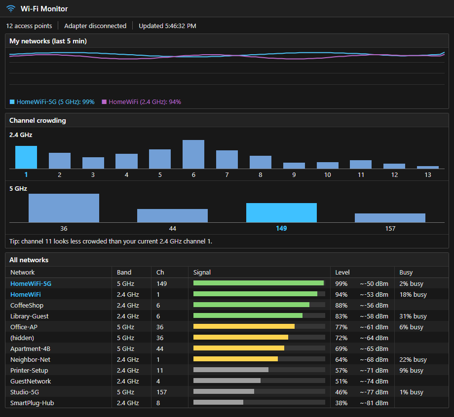

# Wi-Fi Monitor

A local web page that shows the Wi-Fi networks around a Windows PC, their signal strength, and how crowded each channel is.

*Shown with made-up sample networks.*

## What it does

- Lists nearby access points with band, channel and signal strength
- Charts the signal of your own networks over the last 5 minutes
- Shows channel crowding on 2.4 GHz and 5 GHz
- Suggests a less crowded 2.4 GHz channel (1, 6 or 11)
- Shows how busy a channel is when the access point reports it

## How to run

Needs Windows and a Wi-Fi adapter. The adapter does not have to be connected to a network.

1. Optional: open `server.ps1` and add your network names to `$MyNetworks`. The chart, highlighting and channel tip only work for networks listed there.
2. Run `start.bat`. The page opens at `http://localhost:8098`.
3. To stop, press Ctrl+C in the window or close it.

Notes:

- It reads the English text output of `netsh`, so it may not work on Windows set to another language.
- On Windows 11, Location services may need to be on for the scan to list networks.
- The page is only reachable from the same PC.

## Tech

- PowerShell web server, with a Windows WLAN API call to request fresh scans
- One HTML page with plain JavaScript and a canvas chart
- Nothing to install

## What I built

- A scanner that turns `netsh` output into live data for the page
- A channel crowding view that accounts for overlapping 2.4 GHz channels
- A signal history chart for chosen networks
